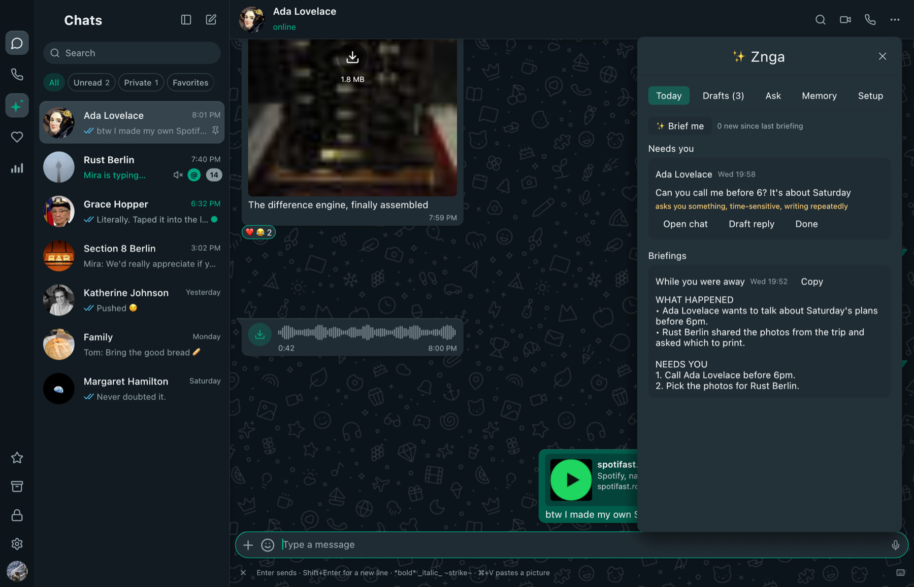

<p align="center">
  
</p>

<h1 align="center">SuperWhatsapp</h1>

<p align="center"><strong>Your WhatsApp, with an AI agent that works ahead of you.</strong><br>
A fast desktop app for macOS, Windows and Linux, with Znga built in: it spots the messages that need you,<br>briefs you on what you missed and drafts replies in your voice. You approve every message.</p>

<p align="center">
  <a href="https://selvakumaresra.github.io/superwhatsapp/download/"><strong>Download</strong></a> ·
  <a href="https://selvakumaresra.github.io/superwhatsapp/znga/">Meet Znga</a> ·
  <a href="https://selvakumaresra.github.io/superwhatsapp/">Website</a> ·
  <a href="https://selvakumaresra.github.io/superwhatsapp/faq/">FAQ</a>
</p>

<p align="center">
  <a href="https://github.com/selvakumarEsra/superwhatsapp/releases"></a>
  <a href="https://selvakumaresra.github.io/superwhatsapp/download/"></a>
  <a href="LICENSE"></a>
</p>

<picture>
  <source media="(prefers-color-scheme: light)" srcset="docs/screenshot-light.png">
  
</picture>

## Why SuperWhatsapp

- **An agent that acts first.** Znga scores every new message on your
  computer and raises the ones that need you: questions, deadlines, plans,
  someone writing again and again, your name in a group.
- **Briefings, not backlogs.** One click sums up what happened and what needs
  you across every chat.
- **Replies in your voice.** Suggested replies, tone tools (friendlier,
  shorter, more formal), translation, and one personal update for several
  people at once. Nothing is sent without your click.
- **Memory that keeps promises.** Znga remembers what you promised and
  reminds you before it is due.
- **Private by design.** An encrypted archive on your computer, an app lock,
  locked chats, and the AI of your choice, including fully local models.
- **Native and fast.** Rust, no browser engine, quick to start and light on memory.
- **Everything else you expect.** Voice messages, media, stickers, polls,
  calls (beta), several numbers, favourites, insights, themes and keyboard
  shortcuts, in 12 languages.

## Get started

1. [Download SuperWhatsapp](https://selvakumaresra.github.io/superwhatsapp/download/)
   for macOS, Windows or Linux.
2. Open it and scan the code with WhatsApp on your phone (Settings › Linked
   devices › Link a device).
3. Click ✨ on the left, open **Setup**, and choose an AI engine for Znga:
   Claude Code, the Claude API, Gemini, an OpenAI-compatible service, or a
   local model with Ollama.

## Build from source

You need a recent stable [Rust](https://rustup.rs), a C/C++ toolchain, CMake
and Perl (plus egui's libraries, ALSA and PipeWire on Linux; see
[Getting started](https://selvakumaresra.github.io/superwhatsapp/getting-started/)).

```sh
git clone https://github.com/selvakumarEsra/superwhatsapp
cd superwhatsapp
cargo run --release
```

`cargo run --features demo -- --demo` opens the app with sample chats and no
account. The new interface (Tauri 2 and Solid.js) is in `src-tauri/` and
`web/`; see [`specs/tauri-ui.md`](specs/tauri-ui.md).

## Releases

Tags `v*` on `main` build macOS, Windows, Linux and Flatpak packages, sign
`checksums.txt` with the project's update key and publish a release
([`release.yml`](.github/workflows/release.yml)). Run the workflow by hand
for a dry run that builds every file without publishing.

## License

SuperWhatsapp is open source under the [MIT license](LICENSE). It connects
through [whatsapp-rust](https://github.com/oxidezap/whatsapp-rust) and draws
its interface with [egui](https://www.egui.rs).

## Disclaimer

SuperWhatsapp is an independent project, not affiliated with, endorsed by or
sponsored by WhatsApp LLC or Meta Platforms, Inc. WhatsApp is a trademark of
WhatsApp LLC. SuperWhatsapp is an unofficial client: using it may be against
WhatsApp's terms of service, and WhatsApp may restrict accounts that use
unofficial clients.
